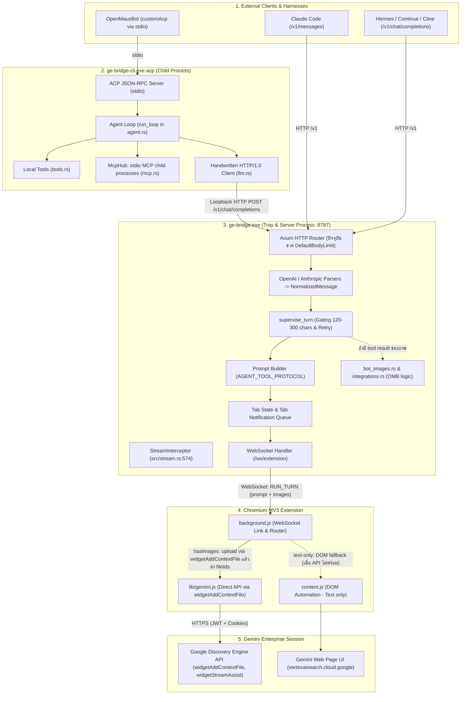

# สถาปัตยกรรม แผนงาน และ Backlog การพัฒนา ge-bridge (Comprehensive Master Plan, v6)
**Architecture Reassessment, Safety Constraints & Execution Backlog**

> v6 (2026-11-17): v5 + review fixes — function map ครบ/เลขบรรทัดถูก, include paths, visibility rule, security constraint 2, TASK-02 upload labeling + decoded-size cap, PowerShell 5.1 command form.

---

## 1. การประเมินสถาปัตยกรรมและเส้นทางการทำงานปัจจุบัน (Current Architecture Assessment)

ge-bridge ทำหน้าที่เป็นสะพานเชื่อมโยง (Bridge) ระหว่าง Web Session ของ Gemini Enterprise (`vertexaisearch.cloud.google`) เข้ากับ External AI Harnesses โดยแบ่งขอบเขตทางกายภาพออกเป็น 3 โปรเซสหลัก:
1. **`ge-bridge.exe` (Main Server & Tray)**: โปรเซสหลักบน Windows รัน Axum HTTP Server บน `127.0.0.1:8787` พร้อมเบื้องหลังเป็น Tokio Runtime (2 threads) และ System Tray Loop บน Main Thread
2. **`ge-bridge-cli.exe acp` (Child Process)**: โปรเซสลูกที่ OpenMausBot สปอว์นผ่าน stdio เพื่อทำหน้าที่เป็น Agent Client Protocol (ACP) Runtime โดยคุยกลับมาหา Server ผ่าน Loopback HTTP
3. **Chromium Extension (MV3)**: เชื่อมต่อกับ Server ผ่าน WebSocket (`/ws/extension`) และทำหน้าที่ยิงคำขอตรงไปยัง Google Discovery Engine Web API ด้วย Session Cookies และ JWT หรือจำลองการทำงานบน DOM หน้าเว็บ



### การแกะรอยเส้นทางการทำงานหลัก (Verified Execution Paths)
1. **Text Request Flow**: ไคลเอนต์ส่งคำขอแชทเข้ามา ตัวแปลง `parse_openai_messages` (`src/stream.rs:22`) หรือ `parse_anthropic_messages` (`src/stream.rs:91`) แปลงข้อมูลเข้าสู่ `NormalizedMessage` (`src/stream.rs:6`) จากนั้นคำนวณ SHA-1 hash ของ history prefix เพื่อตรวจจับการคุยต่อในแท็บเดิม (`newChat: false`) แล้วส่ง `RUN_TURN` ผ่าน WebSocket ไปยัง Extension
2. **Streaming & Supervision Flow**: `supervise_turn` (`src/server.rs:666`) ทำการ Gating กักอักขระเริ่มต้น 120–300 ตัวอักษรเพื่อดักคำปฏิเสธ (Refusal/Policy block) หากพบจะสั่งกู้คืนในแชทใหม่ทันที 1 ครั้งผ่าน `render_recovery_prompt` (`src/stream.rs:488`) หากผ่านจะส่งต่อให้ `StreamInterceptor` (`src/stream.rs:574`) สกัดแท็ก `<tool_call>` ออกเป็น SSE chunks
3. **Image Generation Flow**: เรียกผ่าน `/v1/images/generations` เซิร์ฟเวอร์ส่ง `RUN_IMAGE` ไปยัง Extension ซึ่งเรียก Google Discovery Engine API โดยระบุ `toolsSpec: { imageGenerationSpec: {} }` (`extension/lib/gemini.js:377`) จากนั้นดึง `fileId` มาดาวน์โหลดเป็น Base64 ผ่าน `:downloadFile?alt=media`
4. **Image Input Flow**: เมื่อมีภาพ Base64 เข้ามา Extension ใช้ Direct Web API: เรียก `addContextFile` (`extension/lib/gemini.js:462`) ยิง `widgetAddContextFile` เพื่อรับ `fileId` แล้วส่งต่อใน `streamAssistRequest.fileIds` โดย `transportOrder` (`extension/lib/gemini.js:546`) จะตัด DOM fallback ออกเมื่อมีรูปภาพ
5. **Tool Execution Flow**: เซิร์ฟเวอร์ HTTP ไม่ได้รัน Tool แต่ทำหน้าที่เพียง Render schema และสกัดแท็กข้อความส่งกลับ ส่วนตัวที่รัน Tool จริงคือโปรเซส `ge-bridge-cli acp` ผ่าน LocalTools (`src/acp/tools.rs`) และ McpHub (`src/acp/mcp.rs`)

---

## 2. เมทริกซ์ความต้องการและขอบเขตความสามารถ (Capability Matrix)

| ID | ความสามารถ (Capability) | สถานะปัจจุบัน | External Protocol | Component เจ้าของ | ข้อจำกัดและประเด็นทางเทคนิค | เกณฑ์การยอมรับ (Acceptance Criteria) | Phase |
|---|---|---|---|---|---|---|---|
| **1** | **Text Conversations** | สมบูรณ์ | OpenAI `/v1/chat/completions`, Anthropic `/v1/messages` | Core & Transport | การประมวลผลหยุดชะงักได้หาก Chrome สั่ง sleep แท็บ | แชทโต้ตอบแบบต่อเนื่องได้ถูกต้องตาม Context | Phase 3 |
| **2** | **OpenAI Streaming** | สมบูรณ์ | OpenAI SSE (`chat.completion.chunk`) | Server Handler (`server.rs`) | ไม่รองรับ token count ที่แท้จริง (ส่งค่า 0) | สตรีมข้อความและ tool call deltas ได้เสถียร | Phase 3 |
| **3** | **Anthropic Streaming** | สมบูรณ์ | Anthropic Messages SSE | Server Handler (`server.rs`) | ต้องแยก thinking และ text content block ออกจากกัน | Claude Code ใช้งานได้โดยไม่มี parse error | Phase 3 |
| **4** | **Browser Link** | สมบูรณ์ | WebSocket (`/ws/extension`) | Transport (`link.rs`, `server.rs`) | พึ่งพา Extension ID แบบฮาร์ดโค้ดในการจับคู่ครั้งแรก | สื่อสารสองทางเสถียร ไม่หลุดการเชื่อมต่อ | Phase 3 |
| **5** | **Image Generation** | สมบูรณ์ | OpenAI `/v1/images/generations` | Image Handler (`images.rs`, `lib/gemini.js`) | สร้างได้ครั้งละ 1 ภาพ (`n=1`) | คืนค่า `b64_json` หรือ data URL ได้ภายใน 115s | Phase 3 |
| **6** | **OpenMausBot ACP** | สมบูรณ์ | ACP stdio JSON-RPC | ACP Agent (`acp/agent.rs`) | โค้ดส่ง HTTP Loopback ซ้ำกับ CLI tool | รันคำสั่ง ขอ permission และจัดการไฟล์ใน `cwd` ได้ | Phase 5 |
| **7** | **Model Discovery & Tray** | สมบูรณ์ | `/v1/models`, Win32 Tray | State & Config (`state.rs`, `tray.rs`) | แคช 24 ชม. อาจไม่อัปเดตทันทีเมื่อ tenant เปลี่ยน | แสดงโมเดลและเลือก Default Model ได้ | Phase 3 |
| **8** | **Direct Image Ingress** | รอแก้ Body Limit & Ingress Check | OpenAI `image_url`, Anthropic `image`, ACP `<attached-image>` | Server Ingress & Extension API | **Axum 2MB limit บล็อกคำขอที่มีประวัติภาพสะสมหลายเทิร์น** | คำขอ Multi-turn ที่มีภาพรวม 50MB ผ่านได้ ไม่ติด 413 | **Phase 1** |
| **9** | **Image Ingress Validation** | ขาดการเช็คขนาดและ MIME | HTTP Server Ingress | Server Ingress: `reject_non_base64_images` (`src/server.rs:140` → `src/server/mod.rs` ใน TASK-04) | `is_base64_image` ตรวจแค่ prefix ไม่จำกัดขนาดต่อรูป | คืน 400 ทันทีหาก MIME ไม่อยู่ใน allowlist หรือรูป (decoded) > 10MB | **Phase 1** |
| **10** | **DOM Image Rejection** | ต้องแก้ไข | Error Response Specs | Extension (`lib/gemini.js`, `content.js`) | โค้ดยังคงค้าง `pasteBase64Images` และพยายามรัน | คืน `TURN_DONE` error ทันทีเมื่อสั่ง DOM + images | **Phase 1** |
| **11** | **OMB Logic Consolidation** | ทำงานได้แต่กระจัดกระจาย | Internal Logic | Dedicated Module (`src/omb/`) | โค้ดของ OpenMausBot ฝังตัวอยู่ใน Core Files 4 จุด | ย้ายไปเป็น Plain Functions ใน `omb/` โดยฟังก์ชันคงเดิม | Phase 4 |
| **12** | **HTTP Client Deduplication** | ทำงานได้แต่โค้ดซ้ำ | HTTP/1.0 over TcpStream | Shared Module (`src/http_client.rs`) | โค้ดซ้ำ 2 จุดระหว่าง `acp/llm.rs` และ `ge-bridge-cli.rs` | ยุบรวมเป็น helper เดียวโดยไม่เพิ่ม external crate | Phase 5 |

---

## 3. การวิเคราะห์ช่องว่าง (Gap Analysis)

| ไฟล์ต้นทาง | พฤติกรรมปัจจุบัน | พฤติกรรมเป้าหมาย | เหตุผลความจำเป็น | ความเสี่ยงและมาตรการป้องกัน | การทดสอบเพื่อยืนยัน |
|---|---|---|---|---|---|
| `src/server.rs` (บรรทัด 41-61) | ขาด `DefaultBodyLimit` ทำให้ Axum ตัดคำขอเกิน 2 MB ทิ้งทันที | เพิ่ม `.layer(DefaultBodyLimit::max(100 * 1024 * 1024))` ใน Router | เพื่อรองรับประวัติการแชทที่มีภาพสะสมหลายเทิร์นรวมกันได้สูงสุด 100 MB | คุมความเสี่ยงโดยผูกเฉพาะบน `127.0.0.1` พร้อมบังคับใช้ Auth Token | Integration Test ส่งคำขอสะสม 50 MB ต้องไม่เจอ 413 |
| `src/server.rs:140` (`reject_non_base64_images`) + `src/stream.rs:86` (`is_base64_image`) | ตรวจแค่ prefix `data:image/` ไม่ตรวจ MIME allowlist หรือขนาดต่อรูป | ตรวจ MIME (png/jpeg/webp/gif) และตรวจเพดานรูปภาพไม่เกิน 10 MB หลัง decode (ตรงกับ ACP) คืน 400 ชัดเจน | ป้องกัน Memory Exhaustion และสอดคล้องกับเพดาน 10 MB ของ ACP | ความเสี่ยงต่ำ ช่วยคัดกรอง Payload ที่ผิดพลาดตั้งแต่ Ingress | Unit Tests ทดสอบรูปเกิน 10 MB และ MIME ที่ไม่รองรับ |
| `extension/lib/gemini.js:545` & `content.js:364` | `content.js` ยังเรียก `pasteBase64Images` อยู่ แม้ DOM จะแนบภาพไม่ได้ | `transportOrder()` คืนค่า `[]` เมื่อ `dom && hasImages` และลบ `pasteBase64Images` ทิ้ง | ขจัดโค้ดที่ขัดแย้งกันและแจ้งเตือนผู้ใช้อย่างชัดเจนว่า DOM ไม่รองรับภาพ | ป้องกันพฤติกรรม Silent Failure ที่แชทส่งไปโดยไม่มีภาพ | Unit Test ใน `pacing.test.mjs` และ Live Verification |
| `src/server.rs` (1,425 บรรทัด) | รวม Routing, OpenAI, Anthropic, Supervision, และ WebSocket ไว้ในไฟล์เดียว | แตกออกเป็น `src/server/` ย่อย (`mod.rs`, `openai.rs`, `anthropic.rs`, `supervisor.rs`) | ลดความซับซ้อน อ่านง่าย และตรวจสอบสิทธิ์แยกส่วนได้สะดวก | Pure Relocation: visibility ขยายเป็น `pub(super)` ได้เมื่อเรียกข้าม submodule; parameters, return types และ bodies ไม่เปลี่ยน | Full Test Suite ผ่าน 100% |
| `src/recovery.rs`, `stream.rs`, `server.rs` | Logic เฉพาะของ OpenMausBot แทรกกระจายอยู่ใน Core 4 จุดหลัก | ย้าย Heuristic และตัวกรองของ OMB ทั้งหมดไปรวมใน `src/omb/` | ทำให้ Core Engine สะอาดและรวมศูนย์โค้ดของ OMB ไว้ในโมดูลเดียว | ฟังก์ชันเดิมต้องทำงานได้ผลลัพธ์และรูปแบบข้อความตรงเดิม 100% | Full Test Suite + Live OpenMausBot Turn Test |
| `src/acp/llm.rs` & `ge-bridge-cli.rs` | มีฟังก์ชันเปิด TCP Stream และส่ง HTTP/1.0 ซ้ำกัน 2 จุด | ดึงไปไว้ที่ `src/http_client.rs` เป็นฟังก์ชันกลาง | ลด Code Duplication ตามหลัก DRY โดยไม่ต้องเพิ่ม Crate ภายนอก | คงค่า Timeout และ Buffer Size เดิมทุกประการ | Full Test Suite ผ่าน 100% |

---

## 4. ข้อค้นพบจากการวิจัยและการตัดสินใจ (Research Findings & Decisions)

1. **การสร้างภาพผ่าน `imageGenerationSpec`**:
   - ยืนยันจาก `extension/lib/gemini.js:377` ว่า Gemini Enterprise Discovery Engine Web API รองรับการสร้างภาพโดยตรงผ่าน `toolsSpec: { imageGenerationSpec: {} }` โดยคืน `fileId` และดาวน์โหลด Base64 ผ่าน `:downloadFile?alt=media` สำเร็จโดยไม่ต้องแตะต้อง DOM
2. **รูปแบบ Tag `<attached-image>` ของ OpenMausBot**:
   - OpenMausBot เมื่อรันบน ACP จะแทรก Tag ข้อความว่า `<attached-image path="..." name="..." />` เข้ามาในเนื้อหาข้อความโดยตรง แทนที่จะส่งเป็น Image Block ตามมาตรฐาน ACP เสมอไป (`src/acp/agent.rs:133`) ทำให้ระบบจำเป็นต้องมี Parser สกัด Path เพื่อนำภาพมาแปลงเป็น Base64
3. **ประเด็นคำถามเปิด (Pending User Approval)**:
   - **Q1 (Remote Image URLs)**: *(Recommended, pending approval)* ให้เซิร์ฟเวอร์ปฏิเสธ HTTP Remote Image URL ต่อไปตามเดิม (`reject_non_base64_images`) เพื่อป้องกันความเสี่ยง SSRF ให้ไคลเอนต์แปลงเป็น Base64 Data URL มาเอง
   - **Q2 (MCP Tools Scope)**: *(Recommended, pending approval)* ไม่เปิดให้ HTTP Endpoints เรียกใช้ MCP Tools ในเครื่อง โดยจำกัด MCP ไว้เฉพาะโหมด `ge-bridge-cli acp` สำหรับ OpenMausBot เท่านั้น

---

## 5. Architectural Decision Records (ADRs - Status: Proposed)

#### ADR-1: คงโครงสร้างข้อมูล `NormalizedMessage` เดิม
- **สถานะ**: Proposed
- **การตัดสินใจ**: ไม่สร้าง Type กลางใหม่ (`ContentBlock`, `MediaSource`) คง `NormalizedMessage` (`src/stream.rs:6`) เดิมไว้ ซึ่งรองรับทั้งข้อความ, รูปภาพ, และเครื่องมือครบถ้วนแล้ว
- **ผลลัพธ์**: ขจัดความเสี่ยง Regression ในการแปลงข้อมูล และทำให้ Diff Budget ต่ำที่สุด

#### ADR-2: รวมศูนย์โค้ดเฉพาะทางของ OpenMausBot เข้าสู่ `src/omb/` (OMB code lives in one module)
- **สถานะ**: Proposed
- **การตัดสินใจ**:
  1. สร้างโมดูล `src/omb/mod.rs` เพื่อรวบรวมฟังก์ชันเฉพาะของ OpenMausBot
  2. คงฟังก์ชัน `user_request_text` (`src/recovery.rs:142`) ไว้ใน `src/recovery.rs` โดยสกัดเฉพาะตัวตัด Wrapper (`after_recalled_passages`, `is_omb_meta`, `OMB_TIME_LINE`, `OMB_CONTEXT_PREFIXES`) ไปไว้ใน `src/omb/mod.rs`
  3. ย้าย `tool_bridge` และ `hidden_tools_hint` จาก `src/stream.rs:296-345` ไปไว้ใน `src/omb/mod.rs`
  4. ย้ายการตรวจจับ `[From OpenMausBot` จาก `src/stream.rs:391` และการตรวจจับ `<attached-image` จาก `src/server.rs:783` ไปไว้ใน `src/omb/mod.rs`
  5. รวม `src/bot_images.rs` (ย้ายเป็น `src/omb/disk.rs` บันทึกภาพลงโฟลเดอร์บอต) และ `src/integrations.rs` (ย้ายเป็น `src/omb/link.rs` เชื่อมต่อ config OpenMausBot) เข้ามาอยู่ภายใต้โมดูล `src/omb/`; `save_image_for_bot` ย้ายจาก `src/server/supervisor.rs` ไป `src/omb/disk.rs` ใน TASK-05
- **ผลลัพธ์**: โค้ดของ OMB ถูกรวมไว้ในโมดูลเดียว จัดระเบียบง่าย และ Core Engine เรียกใช้งานตรงๆ ได้ชัดเจน

#### ADR-3: คงสถาปัตยกรรม Tool Execution ไว้ที่ฝั่ง ACP Agent
- **สถานะ**: Proposed
- **การตัดสินใจ**: ไม่สร้าง `ToolRegistry` กลางในเซิร์ฟเวอร์ และไม่เปิดให้เซิร์ฟเวอร์รันเครื่องมือแทนไคลเอนต์ภายนอก ให้ `LocalTools` และ `McpHub` อยู่ใน `src/acp/` สำหรับโหมด OpenMausBot ACP ตามเดิม
- **ผลลัพธ์**: เป็นไปตามหลัก YAGNI ขจัด Abstraction ส่วนเกินที่ไม่มีผู้ใช้งานจริง

#### ADR-4: กำหนด Axum DefaultBodyLimit 100 MB, ใช้ Direct Upload เป็นหลัก และตัด DOM Paste
- **สถานะ**: Proposed
- **การตัดสินใจ**:
  1. เพิ่ม `.layer(DefaultBodyLimit::max(100 * 1024 * 1024))` ใน Axum Router (`src/server.rs`) เพื่อรองรับประวัติการสนทนาที่มีภาพสะสมหลายเทิร์น
  2. เพิ่ม Ingress Validation ตรวจสอบ MIME type (png/jpeg/webp/gif) และจำกัดขนาดไม่เกิน 10 MB ต่อรูป (decoded bytes = base64 length × 3/4) คืน 400 ชัดเจน
  3. ปรับ `extension/lib/gemini.js:545` ให้ `transportOrder()` คืนค่า `[]` เมื่อ `transport === 'dom' && hasImages` และลบฟังก์ชัน `pasteBase64Images` ใน `extension/content.js:364` ออก
- **ผลลัพธ์**: ป้องกันปัญหา HTTP 413, คุ้มครองหน่วยความจำด้วยการจำกัดขนาดรายรูป, และขจัดโค้ดที่ขัดแย้งกันใน Extension

#### ADR-5: รวม Duplicate HTTP/1.0 Client เป็น Helper กลางภายใน
- **สถานะ**: Proposed
- **การตัดสินใจ**: ยุบรวมฟังก์ชันเปิด `TcpStream` และส่งคำขอ HTTP/1.0 ใน `src/acp/llm.rs:51` และ `src/bin/ge-bridge-cli.rs:55` เข้าเป็นฟังก์ชันเดียวใน `src/http_client.rs` โดยไม่ดึง Crate ภายนอกเข้ามา
- **ผลลัพธ์**: โค้ดกระชับขึ้นตามหลัก DRY โดยรักษา Binary Size ที่ถูกบีบอัดไว้เท่าเดิม

---

## 6. ข้อกำหนดด้านความปลอดภัยและความน่าเชื่อถือ (Security & Reliability Constraints)

ทุกงานใน Backlog จะต้องรักษาขอบเขตความปลอดภัยเดิมไว้อย่างเคร่งครัด โดยห้ามเกิด Regression ในประเด็นต่อไปนี้:
1. **Localhost Binding**: เซิร์ฟเวอร์ต้อง Bind เฉพาะบน `127.0.0.1` เท่านั้น ห้ามเปิด Listen บน Public IP หรือ `0.0.0.0`
2. **Origin & Token Authorization (คง per-endpoint auth เดิมทุกจุด)**: ทุก endpoint ที่เรียก `check_auth` วันนี้ (dashboard SSE, status, prefs, refresh models, reset sessions, link OpenMausBot, images, models, chat completions, messages) ต้องเรียกต่อไป โดยตรวจกับ Pairing Token ใน Windows Credential Manager (`keyring`) หรือไฟล์ Fallback `%APPDATA%\ge-bridge\secret.token`; `/api/pair` คงการตรวจ Header `Origin`; WS upgrade คงการตรวจ query token; `/api/health` และ favicon คงเป็น public ตามเดิม
3. **ACP Path Canonicalization & Sandbox Tiers**: การเข้าถึงไฟล์ใน `src/acp/tools.rs` ต้องผ่าน `std::fs::canonicalize` ยึดกับ `cwd` เพื่อป้องกัน Path Traversal อย่างเด็ดขาด พร้อมรักษาระดับสิทธิ์ 3 ระดับ: `Read` (อนุญาตอัตโนมัติ), `Write` (ขอการยืนยัน), `Execute` (ขอการยืนยัน)
4. **WebSocket Lifecycle & Cleanup**: เมื่อ WebSocket ของ Extension หลุดการเชื่อมต่อ เซิร์ฟเวอร์ต้องทำความสะอาด Tab Pool ทันที ป้องกัน Deadlock ในการจองแท็บ
5. **Logging Privacy**: ห้ามบันทึก Base64 Data URLs, Prompt ลับ, หรือ Token ลงใน `server.log` หรือ `extension.log` โดยเด็ดขาด ให้บันทึกเฉพาะ Metadata (เช่น จำนวนตัวอักษร, จำนวนภาพ, เวลา Latency)

---

## 7. แผนที่ฟังก์ชันสำหรับการย้ายโมดูลใน TASK-04 (Function-to-File Map for `src/server.rs`)

TASK-04 เป็น **Pure Relocation**: visibility ขยายเป็น `pub(super)` ได้เมื่อเรียกข้าม submodule; parameters, return types และ bodies ไม่เปลี่ยน (เลขบรรทัดอ้างอิงจาก `src/server.rs` ก่อน TASK-02)

| ฟังก์ชัน / Struct / Const เดิมใน `src/server.rs` | บรรทัดเดิม | ไฟล์ปลายทางใหม่ | บทบาทและความรับผิดชอบ |
|---|---|---|---|
| consts `EXTENSION_ID`, `FAVICON`, `DASHBOARD_TEMPLATE` | L35-37 | `src/server/mod.rs` | **ต้องแก้ path**: `include_bytes!("../../extension/icons/icon32.png")`, `include_str!("../dashboard.html")` (path อ้างจากตำแหน่งไฟล์) |
| `run_http_server` | L39 | `src/server/mod.rs` | สร้าง Router, ผูก DefaultBodyLimit(100MB), จัดการ Listener |
| `check_origin`, `check_auth`, `json_error` | L71, L116, L130 | `src/server/mod.rs` | Middleware ตรวจสอบความปลอดภัยและสร้าง Error response |
| `reject_non_base64_images` (ขยายการตรวจใน TASK-02) | L140 | `src/server/mod.rs` | ใช้ร่วมกันโดย OpenAI (L942) และ Anthropic (L1172): MIME allowlist และขนาดรูป (decoded) ≤ 10MB |
| `cors_preflight_or_404`, `serve_favicon`, `serve_dashboard` | L149, L81, L168 | `src/server/mod.rs` | บริการหน้า Dashboard, Favicon, และจัดการ CORS OPTIONS |
| struct `WsQuery` | L178 | `src/server/mod.rs` | query params ของ WS upgrade (token) |
| `api_health`, `api_pair`, `api_dashboard_sse` | L85, L101, L328 | `src/server/mod.rs` | Endpoint ตรวจสอบสถานะ, การจับคู่ Extension, และ SSE สตรีมสถานะ |
| `api_status`, `api_update_prefs`, `api_refresh_models` | L348, L355, L374 | `src/server/mod.rs` | จัดการ Configuration, Preferences, และ Model Scanning |
| `api_reset_sessions`, `api_link_openmausbot` | L382, L391 | `src/server/mod.rs` | รีเซ็ตเซสชัน และเรียก `crate::integrations` (→ `crate::omb::link` ใน TASK-05) |
| `ws_extension_upgrade`, `handle_extension_ws` | L182, L193 | `src/server/mod.rs` | ควบคุมการเชื่อมต่อ WebSocket สองทางกับ Chromium Extension |
| struct `ModelsQuery` | L406 | `src/server/openai.rs` | query params ของ `/v1/models` |
| `openai_image_generations` | L411 | `src/server/openai.rs` | บริการ `/v1/images/generations` (เรียกใช้ `crate::images`) |
| `openai_list_models` | L479 | `src/server/openai.rs` | บริการ `/v1/models` และ `/models` |
| `openai_chat_completions` | L928 | `src/server/openai.rs` | บริการ `/v1/chat/completions` (OpenAI format & SSE chunks) |
| `anthropic_messages` | L1162 | `src/server/anthropic.rs` | บริการ `/v1/messages` (Anthropic format & SSE content blocks) |
| struct `PreparedJob`, `send_job`, `dispatch_browser_turn` | L525, L538, L574 | `src/server/supervisor.rs` | จองแท็บ, ตรวจ Session Hash, สร้าง Job ID, และส่ง `RUN_TURN` |
| struct `RetryPlan`, `supervise_turn`, `rescue_image` | L654, L666, L863 | `src/server/supervisor.rs` | Gating ตรวจสอบคำปฏิเสธ, จัดการ Retry, และ Image Rescue |
| `save_image_for_bot` | L826 | `src/server/supervisor.rs` | ผู้เรียกเดียวคือ L751; ย้ายไป `src/omb/disk.rs` ใน TASK-05 |
| `commit_session` | L896 | `src/server/supervisor.rs` | บันทึกประวัติและ SHA-1 hash ล่าสุดลงใน `AppState.sessions` |
| `mod tests` | L1357 | `src/server/mod.rs` | tests ของ `check_origin`/`check_auth` (ย้ายตาม function ที่ทดสอบ) |

---

## 8. ยุทธศาสตร์การทดสอบและการย้อนกลับ (Testing & Rollback Strategy)

### ยุทธศาสตร์การย้อนกลับ (Rollback: One Phase = One Commit)
- การทำงานจะถูกแบ่งแยกออกเป็น Commit ที่ชัดเจนในแต่ละ Phase บน Branch แยก (`feat/image-input`)
- **1 Phase = 1 Commit อย่างเคร่งครัด** หากเกิดปัญหาที่ไม่คาดคิด สามารถย้อนกลับการเปลี่ยนแปลงของ Phase นั้นๆ ได้ทันทีด้วยคำสั่ง `git revert <commit_hash>` โดยไม่กระทบงานส่วนอื่น

### คำสั่งทดสอบสำหรับ Refactor Tasks (Full Suite Baseline)
สำหรับงานปรับโครงสร้างโค้ดทั้งหมด (TASK-04, TASK-05, TASK-06) เกณฑ์การยอมรับจะต้องผ่านการรันแบบ **Full Test Suite** เสมอ

Git Bash:
```bash
cargo build --release && cargo test && node --test "tests/unit/*.test.mjs" && node --test "tests/integration/*.test.mjs"
```

Windows PowerShell 5.1 (ไม่รองรับ `&&`):
```powershell
cargo build --release; if ($?) { cargo test }; if ($?) { node --test "tests/unit/*.test.mjs" }; if ($?) { node --test "tests/integration/*.test.mjs" }
```

### การตรวจสอบในระดับ Live End-to-End (Level 4 Verification)
หลังเสร็จสิ้น TASK-04 และ TASK-05 จะต้องทำการทดสอบ Live E2E กับเซสชันจริง 3 รายการ:
1. **Live Gemini Image Smoke Test**: ส่งคำขอแชทพร้อมรูปภาพจริงผ่าน `/v1/chat/completions` ยืนยันว่า `widgetAddContextFile` ทำงานและ Gemini อธิบายภาพได้ถูกต้อง
2. **Live OpenMausBot ACP Turn**: รัน OpenMausBot ทดสอบส่งคำสั่งที่มี `<attached-image>` ยืนยันว่าบอตวิเคราะห์ภาพและทำงานได้ตามปกติ
3. **Live Claude Code Turn**: รันคำสั่ง `claude` บน Terminal ยืนยันว่าสื่อสารผ่าน `/v1/messages` ได้ราบรื่น

---

## 9. Implementation-Ready Backlog

| Task ID | ภารกิจ (Task Description) | ไฟล์เป้าหมาย | คำสั่งทดสอบและเกณฑ์การยอมรับ (Acceptance Criteria) |
|---|---|---|---|
| **TASK-01** | **Build release, verify baseline & commit on new branch** | Working tree diffs | 1. Full suite (§8) ผ่าน 100%<br>2. สร้าง Branch `feat/image-input` และ Commit งานปัจจุบัน |
| **TASK-02** | **Add BodyLimit 100MB, Ingress Image Validation, DOM+images reject & cleanup** | `src/server.rs`, `extension/lib/gemini.js`, `extension/content.js`, `extension/background.js`, `tests/integration/images.test.mjs`, `tests/unit/pacing.test.mjs`, `tests/unit/gemini-api.test.mjs` | 1. เพิ่ม `DefaultBodyLimit::max(100MB)` ใน `src/server.rs`<br>2. ขยาย `reject_non_base64_images` (`src/server.rs:140`): MIME (png/jpeg/webp/gif) และขนาดรูป decoded (base64 length × 3/4) ≤ 10MB คืน 400 ชัดเจน (ตรงกับ ACP `src/acp/agent.rs:129`)<br>3. `transportOrder()` คืนค่า `[]` เมื่อ `dom && hasImages`, ลบ `pasteBase64Images` ใน `content.js`<br>4. เพิ่ม Integration Test ตรวจสอบ 3 ข้อ: (a) คำขอสะสม ~50MB ไม่เจอ 413, (b) รูปภาพถูก parse เข้า `NormalizedMessage`, (c) `RUN_TURN` ส่งเฉพาะภาพเทิร์นปัจจุบัน<br>5. เพิ่ม Unit Test สำหรับ upload step error ใน `tests/unit/gemini-api.test.mjs` และ `tests/unit/pacing.test.mjs`<br>6. **Manual Smoke Test**: ทดสอบส่งรูปภาพจริงกับ Live Gemini Enterprise Session<br>7. **Upload error labeling (code)**: failures จาก `widgetAddContextFile` ที่เก็บใน `extension/background.js:363` ต้องระบุ step upload ใน `TURN_DONE` error |
| **TASK-03** | **Add inline snapshot unit tests for `render_turn_prompt`** | `src/stream.rs` | เพิ่ม `#[test]` ครอบคลุม: ข้อความล้วน, มี Tools, Continuation turn, และมีรูปภาพ<br>Acceptance: `cargo test prompt_snapshot` ผ่าน 100% |
| **TASK-04** | **Split `src/server.rs` into `src/server/` submodules (Pure Relocation)** | `src/server/mod.rs`, `openai.rs`, `anthropic.rs`, `supervisor.rs` | ย้ายตาม **Function-to-File Map** (§7) รวม consts/structs/tests; แก้ `include_bytes!`/`include_str!` paths; visibility ขยายเป็น `pub(super)` ได้ แต่ parameters/return types/bodies ไม่เปลี่ยน<br>Acceptance: **Full Test Suite ผ่าน 100%** |
| **TASK-05** | **Consolidate OMB heuristics into `src/omb/` (Pure Relocation)** | `src/omb/mod.rs`, `src/omb/disk.rs`, `src/omb/link.rs`, `src/recovery.rs`, `src/stream.rs`, `src/server/supervisor.rs` | 1. ย้าย wrapper filters จาก `recovery.rs`, `tool_bridge`/`hidden_tools_hint` จาก `stream.rs`, `[From OpenMausBot` จาก L391, และ `<attached-image` จาก L783 ไปไว้ใน `src/omb/mod.rs`<br>2. ย้าย `bot_images.rs` → `src/omb/disk.rs` (รวม `save_image_for_bot` จาก `supervisor.rs`), `integrations.rs` → `src/omb/link.rs`<br>Acceptance: **Full Test Suite ผ่าน 100%** + Live OMB Turn Test + Live Claude Code Turn Test |
| **TASK-06** | **Deduplicate raw HTTP/1.0 client helper into `src/http_client.rs`** | `src/http_client.rs`, `src/acp/llm.rs`, `src/bin/ge-bridge-cli.rs` | ยุบรวมฟังก์ชันเชื่อมต่อ TCP และส่ง HTTP/1.0 เป็น Helper กลางตัวเดียว โดยไม่เพิ่ม external crate<br>Acceptance: **Full Test Suite ผ่าน 100%** |

---

## 10. สรุปความพร้อมในการดำเนินการ

แผนงานฉบับสมบูรณ์นี้ได้รวมเนื้อหาสำคัญจาก v1-v5 กลับมาอย่างครบถ้วน:
- มีการคุมเข้มขนาดรูปภาพทั้งรายรูป (10 MB per-image cap, decoded) และเพดานทั้งคำขอ (100 MB request cap)
- มีการทดสอบยืนยันทั้งในระดับ Unit, Integration (~50 MB multi-turn payload), และ Live E2E
- มี Function-to-File Map ที่ครบถ้วน (รวม consts, structs, tests) สำหรับตรวจเช็คการย้ายโค้ด
- โค้ดของ OpenMausBot ถูกจัดระเบียบรวมไว้ในโมดูล `src/omb/` เดียวอย่างเป็นระบบ
- มีกลยุทธ์ Rollback ที่ปลอดภัย (1 Phase = 1 Commit บน Branch แยก)

**สถานะปัจจุบัน**: ผู้ใช้อนุมัติให้เริ่ม implement (2026-11-17) เริ่มที่ **TASK-01**
